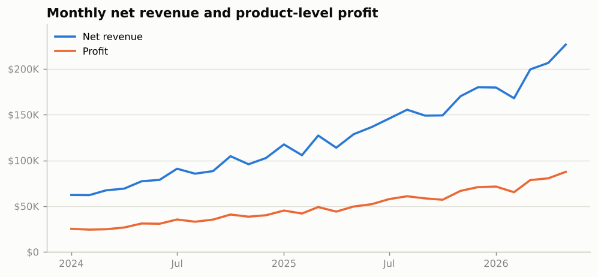
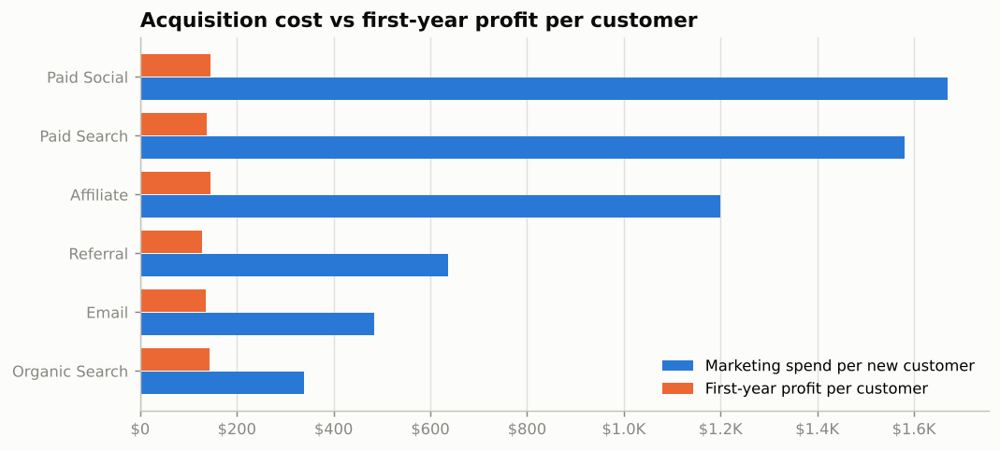
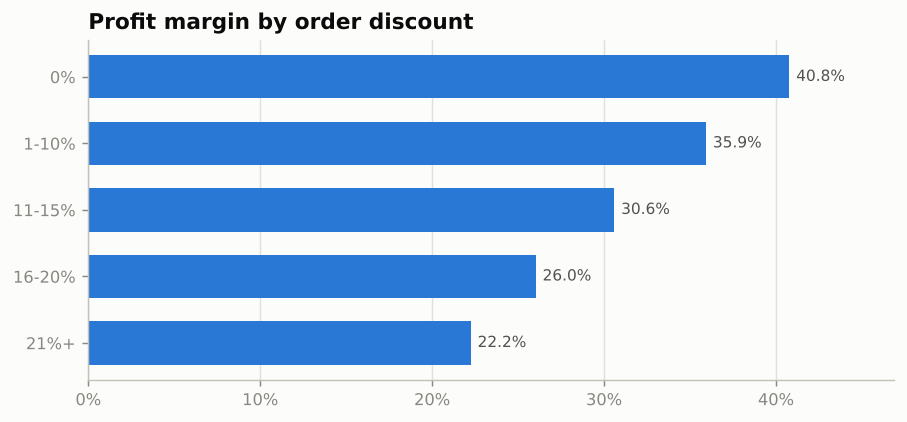
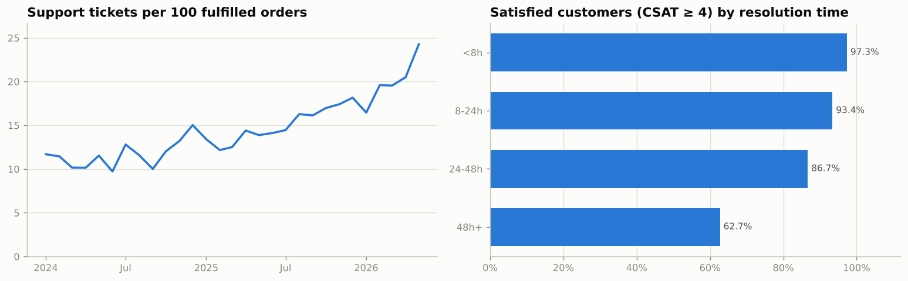
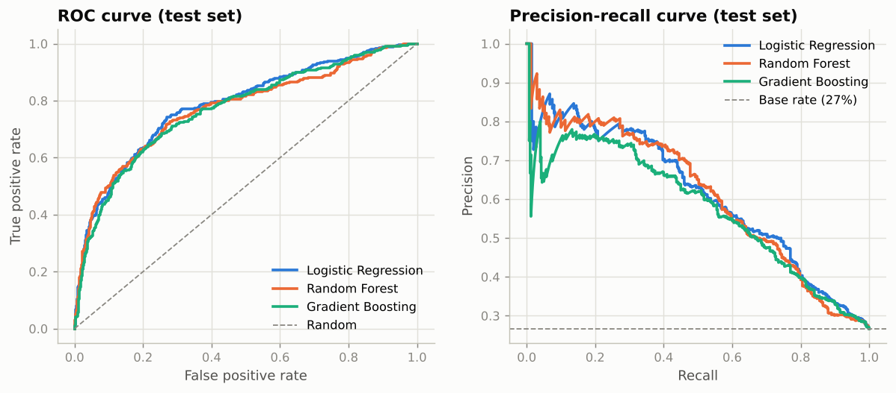
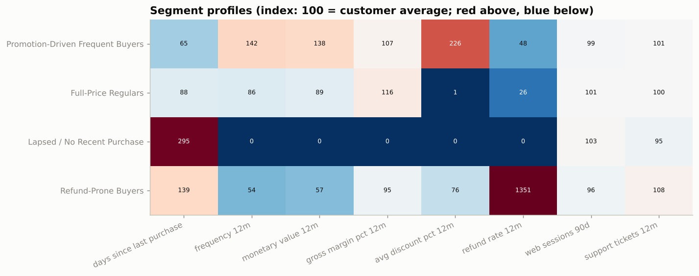
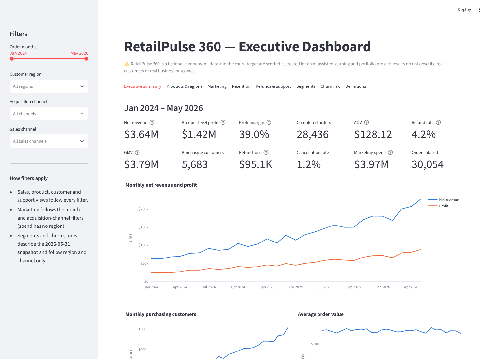
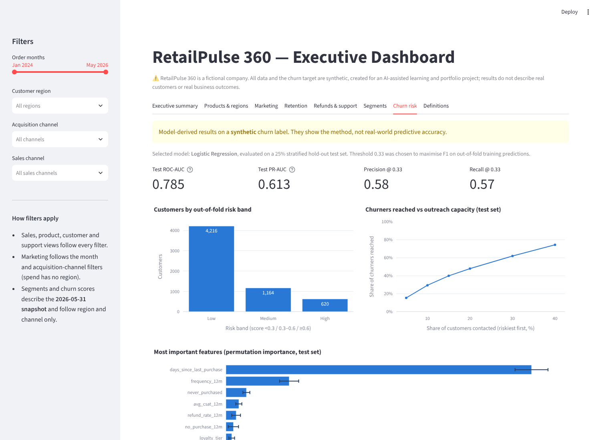
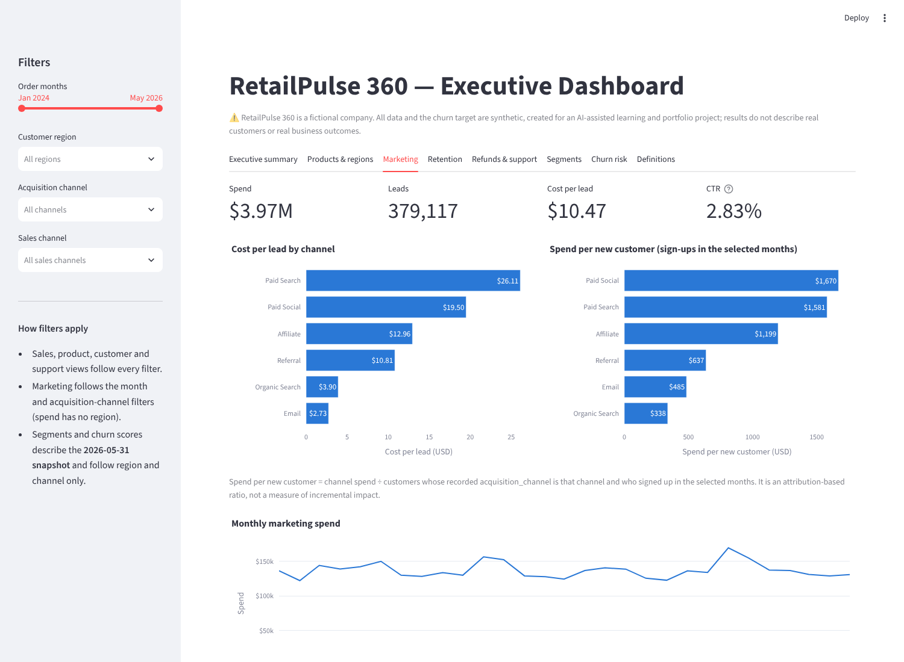
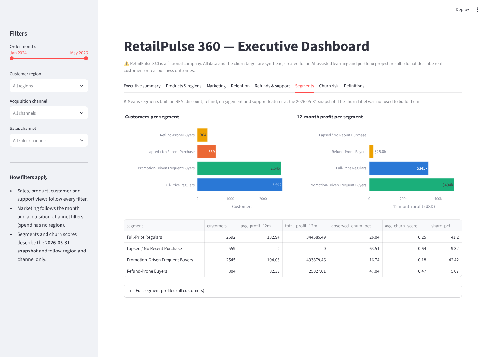

# RetailPulse 360 — Customer Growth, Churn & Segmentation Analytics

An end-to-end data analytics case study for a **fictional** U.S. e-commerce retailer. It covers data-quality auditing, KPI design, PostgreSQL analysis, exploratory analysis in Python, churn prediction, customer segmentation, an interactive Streamlit dashboard and evidence-based business recommendations.

> **⚠️ Synthetic data disclosure.** RetailPulse 360 is not a real company. All datasets and the churn target are **synthetic**, created for an AI-assisted learning and portfolio project. Nothing in this repository describes real customers, transactions or business results, and model performance on this data does not prove real-world predictive accuracy. The project was not commissioned by any company.

---

## 1. Business problem

RetailPulse 360 grew quickly, but leadership is concerned about uneven profitability, refunds, marketing efficiency and customer retention. They want one analytics system that answers:

1. What drives revenue, profit, conversion, refunds and retention?
2. Which customers are likely to churn in the next 90 days?
3. Which customer segments exist, and how should each be treated?
4. Which channels, products and regions deserve more attention?
5. What should leadership do next, and how should the results be measured?

## 2. Key findings (from executed analysis)

<!-- KEY-FINDINGS:START -->
| Metric (Jan 2024 – May 2026) | Value |
|---|---|
| Net revenue / GMV | $3.64M / $3.79M |
| Product-level profit (margin) | $1.42M (39.0%) |
| Completed orders / AOV | 28,436 / $128.12 |
| Refund rate / cancellation rate | 4.2% / 1.2% |
| Recorded marketing spend | $3.97M |
| Repeat-purchase rate (2+ orders) | 87.9% |

1. **Volume-driven growth:** Jan–May 2026 net revenue is 65.4% above Jan–May 2025, while AOV stayed flat ($128.59 → $126.64).
2. **Acquisition cost far exceeds early customer profit:** Paid Social spends $1,670 and Paid Search $1,581 per new customer, against first-year profit of about $146 per customer. Total marketing spend exceeds total product-level profit.
3. **Discounts cost margin:** profit margin falls from 40.8% (no discount) to 22.2% (21%+ discount).
4. **Support strain:** tickets per 100 fulfilled orders rose from 11.7 to 24.3. Satisfaction drops sharply for tickets taking longer than 48 hours.
5. **Churn model (Logistic Regression):** CV ROC-AUC 0.782 ± 0.017; test ROC-AUC 0.785, PR-AUC 0.613 (base rate 26.7%). At threshold 0.33: precision 0.58, recall 0.57. The top 20% riskiest customers contain 47.8% of churners. *Synthetic label: not a real-world accuracy claim.*
6. **Segments (K-Means, k = 4, silhouette 0.23, seed-stability ARI 1.00):** Promotion-Driven Frequent Buyers (42% of customers, churn 17%); Full-Price Regulars (43% of customers, churn 26%); Lapsed / No Recent Purchase (9% of customers, churn 64%); Refund-Prone Buyers (5% of customers, churn 47%).
<!-- KEY-FINDINGS:END -->

The findings above are generated from code by `scripts/run_pipeline.py`. Full write-ups: [`reports/business_recommendations.md`](reports/business_recommendations.md) and [`reports/data_quality_report.md`](reports/data_quality_report.md).

| | |
|---|---|
|  |  |
|  |  |
|  |  |

## 3. Dataset

| Table | Rows | Grain | Notes |
|---|---:|---|---|
| `customers` | 6,000 | customer | sign-ups from 2023-01 to 2026-05; region, acquisition channel, device, loyalty tier |
| `products` | 120 | product | 6 categories, base price and unit cost |
| `orders` | 30,054 | order | 2024-01-01 to 2026-05-31; status: Completed / Refunded / Cancelled |
| `order_items` | 56,183 | order line | quantity, price, discount, line revenue and cost |
| `web_sessions` | 76,327 | session | funnel flags (product views, cart adds, checkout, conversion) |
| `support_tickets` | 4,662 | ticket | issue type, priority, resolution hours, CSAT 1–5 |
| `marketing_spend` | 174 | month × channel | spend, impressions, clicks, leads |
| `customer_modeling_snapshot` | 6,000 | customer | 20 features at 2026-05-31 + synthetic target `churned_next_90d` |

All row counts were verified against the files. The audit, covering keys, relationships, reconciliation, outliers, leakage and synthetic artifacts, is in [`reports/data_quality_report.md`](reports/data_quality_report.md). Column definitions: [`docs/data_dictionary.csv`](docs/data_dictionary.csv). Metric definitions: [`docs/metric_definitions.md`](docs/metric_definitions.md).

**Important data findings:** net revenue = GMV + shipping on Completed orders only; refunded orders keep their merchandise cost (a loss); every snapshot feature was rebuilt exactly from pre-snapshot events (no leakage); and the snapshot's `recency_days` uses a sentinel value (`signup + 30 days`) for 606 customers, which the models replace with true recency.

## 4. Technical stack

| Area | Tools |
|---|---|
| Data & analysis | Python 3.11+, pandas, NumPy |
| SQL | PostgreSQL 16 (CTEs, window functions, views, constraints) |
| Machine learning | scikit-learn (Pipelines, Logistic Regression, Random Forest, HistGradientBoosting, K-Means) |
| Visualisation | matplotlib (reports and notebooks), Plotly + Streamlit (dashboard) |
| Quality | pytest (data-quality, metric, leakage, model, segmentation, report, SQL-vs-pandas and dashboard tests), GitHub Actions CI |
| Notebooks | Jupyter (executed end-to-end, outputs committed) |

## 5. Repository structure

```
retailpulse360-portfolio/
├── data/
│   ├── raw/                    # 7 source CSVs (read-only inputs, never modified)
│   └── processed/              # provided customer modeling snapshot
├── notebooks/
│   ├── 01_data_quality_eda.ipynb
│   ├── 02_churn_prediction.ipynb
│   └── 03_customer_segmentation.ipynb
├── sql/                        # PostgreSQL: 01 schema → 02 load → 03–14 analysis, run_all.sh
├── src/retailpulse360/         # reusable, tested Python package
│   ├── config.py  data.py  quality.py  metrics.py  features.py
│   ├── modeling.py  segmentation.py  plotting.py  reporting.py  pipeline.py
├── scripts/run_pipeline.py     # regenerates every report, table and figure
├── dashboard/app.py            # Streamlit executive dashboard
├── reports/
│   ├── data_quality_report.md  business_recommendations.md  model_metrics.json
│   ├── figures/                # charts + dashboard screenshots
│   └── tables/                 # KPI, model and segment tables (CSV)
├── docs/                       # methodology, metric definitions, architecture, interview guides, Power BI + SQL guides
├── tests/                      # pytest suite
└── .github/workflows/tests.yml # CI
```

## 6. Business questions answered

| Question | Where |
|---|---|
| Is the data trustworthy, and how should KPIs be defined? | Notebook 01 §2, `sql/03`, data-quality report |
| How are revenue, profit, orders, customers and AOV trending? | Notebook 01 §4, `sql/04`, dashboard *Executive summary* |
| Which categories and regions drive revenue and profit? | Notebook 01 §5–6, `sql/05`, `sql/06` |
| Which acquisition channels bring valuable customers, and at what cost? | Notebook 01 §6–7, `sql/07`, `sql/13` |
| What drives refunds and support load? | Notebook 01 §9–10, `sql/09`, `sql/10` |
| What are repeat-purchase and retention patterns? | Notebook 01 §11, `sql/08`, `sql/12` |
| Who is likely to churn in the next 90 days? | Notebook 02, dashboard *Churn risk* |
| What actionable customer segments exist? | Notebook 03, `sql/11` (RFM), dashboard *Segments* |
| What should leadership do? | `reports/business_recommendations.md` |

## 7. Dashboard

The Streamlit dashboard recomputes every KPI from the raw data for the selected filters (months, region, acquisition channel, sales channel). Ratios such as AOV and refund rate are always recalculated from totals, never averaged. It has eight tabs: executive summary, products & regions, marketing, retention, refunds & support, segments, churn risk and metric definitions.

| Executive summary | Churn risk |
|---|---|
|  |  |
| **Marketing** | **Segments** |
|  |  |

*Screenshots were captured from the running app on the project data.*

```bash
streamlit run dashboard/app.py      # then open http://localhost:8501
```

A Power BI version can be built by following [`docs/power_bi_build_guide.md`](docs/power_bi_build_guide.md). No `.pbix` file is included.

## 8. Installation and execution

```bash
git clone https://github.com/mansidevi8128-glitch/retailpulse360-portfolio.git
cd retailpulse360-portfolio
python -m venv .venv && source .venv/bin/activate      # Windows: .venv\Scripts\activate
pip install -r requirements.txt
pip install -e .                                        # makes `retailpulse360` importable everywhere

python scripts/run_pipeline.py                          # regenerate reports/, figures and README findings (~30 s)
pytest                                                  # run the test suite (SQL tests skip without PostgreSQL)
jupyter nbconvert --to notebook --execute --inplace notebooks/*.ipynb   # re-run the notebooks
streamlit run dashboard/app.py                          # launch the dashboard
```

Tested with Python 3.13 locally and Python 3.12 in CI. All paths are relative to the repository root.

## 9. SQL

PostgreSQL scripts live in [`sql/`](sql/). `01_schema.sql` creates the tables with primary keys, foreign keys and CHECK constraints. `02_load_data.sql` loads the CSVs with `\copy`. Scripts `03`–`14` cover data quality, monthly KPIs, category profitability, regions, acquisition channels, repeat purchase, refunds, support/CSAT, RFM, cohort retention, marketing efficiency and the customer feature table.

```bash
createdb retailpulse360
bash sql/run_all.sh retailpulse360        # runs every script in order; results in sql/output/
```

Step-by-step instructions, including pgAdmin: [`docs/sql_data_loading_guide.md`](docs/sql_data_loading_guide.md). All scripts were executed successfully on **PostgreSQL 16.15**. `tests/test_sql_postgres.py` rebuilds the database and checks that the SQL results match the pandas results (monthly KPIs, category profit, first-year value, cohort retention, and a 0-mismatch rebuild of the snapshot features).

## 10. Churn model: method, evaluation and limitations

- **Target:** `churned_next_90d` (synthetic) at the 2026-05-31 snapshot; base rate about 27%.
- **Leakage controls:** every feature was rebuilt from events on or before the snapshot date (test-enforced). IDs, the target and the snapshot date are blocked by `assert_no_leakage`. The recency sentinel was replaced with true recency plus flags. All preprocessing happens inside scikit-learn Pipelines.
- **Models:** Logistic Regression (baseline), Random Forest and Histogram Gradient Boosting, compared with stratified 5-fold cross-validation on a 75% training set. The 25% test set is used once.
- **Selection:** best CV PR-AUC, preferring Logistic Regression when within 0.01. Logistic Regression was selected.
- **Threshold:** maximises F1 on out-of-fold *training* predictions, then applied to the test set. A capacity table shows precision and recall if only the riskiest X% can be contacted; the capacity levels are assumptions.
- **Interpretation:** permutation importance (time since last purchase dominates) and standardised coefficients, with a caveat about correlated value features.
- **Limitations:** synthetic label; single snapshot (no out-of-time validation); static attributes such as loyalty tier could leak if assigned after the snapshot; predicting churn is not the same as predicting response to an offer.

## 11. Customer segmentation

K-Means on eight log-transformed, standardised behavioural features (recency, frequency, monetary value, margin, discount, refund rate, web sessions, support tickets). k is chosen by a written rule: the highest silhouette among k ≥ 3 with no cluster under 5% of customers. Segments are named from their profiles using transparent rules, and churn is joined only afterwards to describe them. Cluster separation is moderate (silhouette ≈ 0.23), and this is stated in the notebook. Each segment gets a recommended action to test and the metrics to monitor (Notebook 03 §8).

## 12. Documentation

| Document | Contents |
|---|---|
| [`docs/methodology.md`](docs/methodology.md) | end-to-end approach and design decisions |
| [`docs/metric_definitions.md`](docs/metric_definitions.md) | every KPI formula, grain and edge case |
| [`docs/technical_architecture.md`](docs/technical_architecture.md) | code structure, data flow and testing |
| [`docs/sql_data_loading_guide.md`](docs/sql_data_loading_guide.md) | loading the CSVs into PostgreSQL |
| [`docs/power_bi_build_guide.md`](docs/power_bi_build_guide.md) | data model, DAX measures and page layouts for a Power BI version |
| [`docs/interview_walkthrough.md`](docs/interview_walkthrough.md) | how to present the project in 2, 5 and 15 minutes |
| [`docs/interview_questions_and_answers.md`](docs/interview_questions_and_answers.md) | likely questions with answers grounded in this project |
| [`docs/data_dictionary.csv`](docs/data_dictionary.csv), [`docs/dataset_notes.md`](docs/dataset_notes.md), [`docs/project_brief.md`](docs/project_brief.md) | original dataset documentation |

## 13. Known limitations and future improvements

**Limitations**
- Synthetic data: distributions are cleaner and more uniform than real data, and the churn label is generated.
- Profit is product-level only. Shipping, fulfilment, payment, support and overhead costs are not in the data.
- Marketing attribution is a single recorded acquisition channel; there are no incrementality experiments.
- Support tickets are not linked to orders; sessions are not linked to orders.
- Order history starts in January 2024, so 2023 sign-ups are left-censored.

**Future improvements**
- Build several monthly snapshots for out-of-time churn validation and drift monitoring.
- Add cost data to compute contribution margin and customer lifetime value.
- Design A/B and holdout tests for marketing spend, discount policy and retention outreach, and use uplift modelling.
- Schedule the pipeline (e.g. a GitHub Actions cron) and publish the dashboard to Streamlit Community Cloud.
